# Hyper-Connections reading guide

[← Back to the catalog](../README.md) · [Audit and source verification](search-audit-2026-11-09.md)

This guide covers Zhu et al.'s residual-stream Hyper-Connections (HC), Frac-Connections, GHC/DGHC, mHC, Identity HC/iHC, xHC, and related work on constraints, parameterization, stability, systems, and applications. The catalog is a dated, source-verified snapshot, not an exhaustive registry or an independent reproduction.

- [Inclusion policy](#inclusion-policy)
- [Date conventions](#date-conventions)
- [Background and notation](#background-and-notation)
- [Research lineage](#research-lineage)
- [Identity HC / iHC provenance](#identity-hc--ihc-provenance)
- [Method comparison](#method-comparison)
- [Current frontier](#current-frontier)
- [Suggested reading order](#suggested-reading-order)
- [Repository classification and metadata](#repository-classification-and-metadata)

## Inclusion policy

### Included as direct research

A paper is included in the direct count when it reports completed experiments, proofs, or mechanism analysis and at least one of the following is true:

1. it proposes a new HC/mHC-family connection rule, constraint, parameterization, or systems implementation;
2. it directly analyzes the behavior of HC/mHC residual streams;
3. HC/mHC is a material architectural contribution in the paper rather than a passing baseline;
4. it adapts HC/mHC to a new training regime, inference algorithm, or application domain.

### Separated as adjacent/adoption

Papers receive the **Adjacent/Adoption** track when HC/mHC is important to the experiment or model, when the paper formalizes a broader residual question that explicitly covers HC/mHC, or when it reports a substantive controlled comparison against HC/mHC, but its main contribution is broader than hyper-connections.

### Indexed but not counted

Concept proposals without completed experiments or proofs, and runtime studies in which an HC/mHC tensor is only an observed pipeline boundary rather than the research target, receive the **Indexed · Not counted** track and are excluded from the publication count. Candidates without sufficient primary evidence are kept in the [separate pending list](../README.md#pending-verification), outside the timeline.

### Code and resource labels

- **Author/paper code** is linked by the paper, author, or research group, or clearly hosts the experiments for that paper.
- **Independent implementation** is a third-party reimplementation or extension and is never presented as official code.
- **Ecosystem integration** is HC/mHC support inside a larger training, inference, or kernel framework.
- **Paper/runtime artifact** is tied to a relevant paper or exact experiment but is not represented as an HC/mHC implementation unless its current source tree contains one.
- Forks and mirrors are deduplicated to their upstream repository. Empty repositories, “coming soon” placeholders, and copied single-file stubs without meaningful documentation are omitted.

### Excluded

- papers that only cite HC/mHC;
- unrelated uses of “hyperconnection,” “hyper-connected,” or “HC”;
- hypergraph, networking, neuroscience, and database papers that do not descend from the residual-stream formulation;
- blog posts, social-media experiments, and implementation notes without a formal paper. These may be mentioned for provenance, but are not counted as papers.
- automatically generated research artifacts without stable authorship or independent scholarly review; two such FARS outputs are documented in the [audit](search-audit-2026-11-09.md#audit-method-and-known-exclusions) but are not counted.
- model cards, repositories, package pages, tutorials, and technical blogs without a formal paper; these are tracked as resources, not publication items.

AI-assisted manuscripts with identifiable responsible authors and completed proofs/experiments may qualify under the same evidence policy; assistance and unreviewed status are disclosed. Inclusion is not independent reproduction or a quality endorsement.

## Date conventions

**First public date** means the first publicly verifiable version containing the relevant HC/mHC material. A later revision determines the date if earlier versions lacked that material; an earlier proceedings version takes precedence over a later arXiv deposit. The [paper timeline](../README.md#papers) is sorted newest first, with title as the same-day tiebreaker.

## Background and notation

A convenient generic form of the HC-family update is

```text
X_(l+1) = H_res,l X_l + H_post,l^T F_l(H_pre,l X_l),
```

where `X_l` contains `n` parallel residual streams:

- `H_pre` reads and aggregates information from the streams before the Transformer sublayer;
- `H_post` writes the transformed output back to the streams;
- `H_res` transports and mixes residual-stream states across depth.

The literature repeatedly revisits four questions:

1. How many residual streams should be maintained?
2. How should a sublayer read from and write to those streams?
3. What constraint on `H_res` prevents exploding, vanishing, or homogenizing matrix products?
4. How can expanded residual state and dynamic routing be implemented without becoming memory-bandwidth bound?

## Research lineage

```mermaid
flowchart TD
    R[Residual connections] --> HC[Hyper-Connections]
    HC --> FRAC[Frac-Connections]
    HC --> VWN[Virtual Width Networks: GHC / DGHC]
    HC --> MHC[mHC: Birkhoff-constrained mixing]
    HC --> FLUID[FLUID: Liquid Hyper-Connections]

    MHC --> HARM[Harmonized HC: feedback control]
    MHC --> LITE[mHC-lite]
    MHC --> KROM[KromHC]
    MHC --> JPM[JPmHC]
    MHC --> BE[Birkhoff-Exact HC]
    MHC --> SPARSE[SHC: Sparse Selective HC]
    MHC --> SHC[s²HC: spectral-sphere HC]
    MHC --> OHC[oHC: quaternion SO4 rotations]
    MHC --> UNI[Uni-mHC: unistochastic mixing]
    MHC --> GO[go-mHC]
    MHC --> EDELTA[EΔ-MHC-Geo]
    MHC --> TBP[TBP-mHC]
    MHC --> FAST[Accelerated Birkhoff projection]
    MHC --> TEMPER[TEMPER]
    MHC --> CIRC[C-mHC: circulant exact mixing]
    MHC --> IHC[Identity HC: H_res = I]
    MHC --> XHC[xHC / xHC-Flash]
    MHC --> SINGLE[Single-Pass mHC / Mega-mHC]
    MHC --> DAR[Dual Attention Residuals: two-stream block transport]
    IHC --> GR[GatedResidual: feature-wise reads]
    IHC --> SIHC[SiHC: spatially indexed streams]
    IHC --> SIMPLE[SimpleHC: shared group-entry state]

    MHC --> ANALYSIS[Reproduction, ablation, and stream-collapse analysis]
    MHC --> MSSM[mHC-SSM]
    MHC --> APP[Applications and systems]
    IHC --> CHIMERA[Chimera: iHC]
```



## Identity HC / iHC provenance

**Identity HC is a variant/ablation, not a standalone paper.**

1. The later ICML 2026 version of **[mHC](https://openreview.net/forum?id=mDhyxu8WRb)** contains an ablation named **Identity HC**.
2. Its defining simplification is

   ```text
   H_res,l = I
   ```

3. Dynamic/adaptive `H_pre` and `H_post` remain. Therefore, the sublayer can still read an input-dependent mixture of streams and write the result back with input-dependent weights. What disappears is the explicit `n×n` residual-state transition and its Sinkhorn projection.
4. **[Chimera](https://arxiv.org/abs/2607.28611)** later uses the full name **Identity Hyper-Connections (iHC)** and deploys the design as an architectural component.

Recommended citation convention:

- cite the later mHC/ICML version for the **Identity HC ablation provenance**;
- cite Chimera for the explicit **Identity Hyper-Connections (iHC)** terminology and its use in a model architecture.

Informal posts reporting large Identity-HC experiments are not counted as papers in this repository.

## Method comparison

| Method | Residual transition / constraint | Cross-stream interaction | State-width / systems profile | Main trade-off |
|---|---|---|---|---|
| Residual connection | Fixed identity | Single stream | `C` | Stable but rigid |
| HC | Unconstrained learned/dynamic `H_res` | Adaptive read, write, and residual mixing | About `nC` residual state | Expressive, but deep products can be unstable and memory traffic grows |
| Frac-Connections | Routing among hidden-state fractions | Interaction among partitions | About `C` residual state | Lower memory cost, but less virtual-width capacity |
| GHC / DGHC | Generalized carry/read/write maps | Flexible virtual-to-backbone routing | Configurable virtual width | General formulation; more routing machinery |
| mHC | Doubly stochastic `H_res` via Sinkhorn | Full residual mixing plus adaptive read/write | `nC` plus projection/routing overhead | Stable large-scale training, but projection and I/O add cost |
| Harmonized HC | Feedback-controlled applied composite gain | Unconstrained local routing under a global gain budget | Controller plus composite-gain tracking | Preserves selective amplification, but evidence is currently limited to an institutional preprint and controlled retrieval experiments |
| mHC-lite / BE-HC | Exact Birkhoff construction | Full constrained residual mixing | Avoids iterative Sinkhorn; complete permutation bases can scale poorly | Exactness versus combinatorial basis size |
| Sparse Selective HC (SHC) | Sparse permutation/orthogonal routing | Selective multi-stream exchange | Targets lower routing and cache cost | Sparse structure improves efficiency but restricts available routes |
| KromHC | Kronecker-factorized exact doubly stochastic mixer | Structured residual mixing | Better stream-count scaling | Efficiency at the cost of factorized structure |
| go-mHC / TBP-mHC | Exact direct parameterizations | More complete Birkhoff coverage | No iterative Sinkhorn | Parameterization complexity and implementation maturity |
| TEMPER | Tensor-network generators feeding manifold routing | Token-dependent read/mix/write maps | Reduces generator parameter growth at larger stream counts | Rank/efficiency trade-off and newer implementation ecosystem |
| C-mHC | Softmax-weighted circulant permutation mixture; exactly doubly stochastic | Translation-equivariant, commutative cyclic mixing | `n` mixer coefficients, one softmax, Fourier-diagonalizable products; full `nC` state remains | Strong structural restriction versus the full Birkhoff polytope; evidence is an unreviewed, small-scale repository manuscript |
| JPmHC / EΔ-MHC-Geo | Orthogonal or spectrum-controlled manifolds | Rotation/reflection-style mixing | Geometry-dependent | Strong Jacobian/norm control with additional geometric machinery |
| s²HC | Spectral-sphere constraint; negative entries allowed | Additive and subtractive mixing | Avoids Sinkhorn and permutation enumeration | More expressive feasible set under a different stability constraint; same paper previously abbreviated sHC |
| oHC | Orthogonal `SO(n)` residual rotations; quaternion construction for `n=4` | Signed, norm-preserving residual exchange | Constant-size closed form for four streams; full `nC` state remains | Preserves differences rather than averaging them, but abandons nonnegative stochastic mixing |
| Uni-mHC | Phase-projected real `W = Re(U diag(exp(iφ)))`; auxiliary `S = abs(U)^2` is doubly stochastic | Signed stream mixing with phase control | Unitary parameterization; full `nC` state remains | Applied `W` is not a Birkhoff-constrained residual operator; independent unreviewed toy/short-run evidence |
| Identity HC / iHC | `H_res = I` | No direct residual-transition mixing; adaptive read/write remain | Removes dynamic `n×n` mixer and Sinkhorn | Simplicity and stability versus giving up explicit residual-stream exchange |
| SimpleHC | `H_res = I`; layer-specific gates from shared group-entry state | Adaptive read/write; scalar corrections account for earlier group writes | Keeps full-width streams; batches reads and defers writes | Less activation traffic, not latent-state compression; gate inputs no longer depend on every intermediate state |
| GatedResidual (GR) | Identity carry; feature-wise input gates and scalar per-stream writes | Learned gated reads/writes without a residual mixer | Four full-width streams in Qwen3.8; low-rank controller is not latent-state compression | Removes Sinkhorn/mixing work while retaining expanded persistent state |
| SiHC | Identity carry with static feature-wise read/write maps | Spatially indexed streams for diffusion-transformer subpatches | Targets persistent-state traffic and fused read/write kernels | Diffusion-specific bandwidth/representation trade-off, not interchangeable with token-dynamic mHC |
| xHC | Large-`N` sparse update with dense access | Rich read/write; subset of streams updated per layer | Demonstrated at `N=16`; xHC-Flash reduces memory traffic | Makes stream count scalable while retaining a wider persistent state |
| Single-Pass mHC | Carries the next input-mixing coefficients from the preceding block | Delayed read coefficients with dynamic residual/write maps | Mega-mHC fuses update/read/coefficient prediction and normalization; reported deployment activation traffic `(4n+4)d → (2n+2)d` | Changes coefficient timing rather than compressing persistent streams; source is the V4.1 technical report |

## Current frontier

As of **2026-11-09**, the main research directions are:

- **Does learned residual mixing matter?** Identity HC/iHC and stream-collapse results suggest that adaptive read/write may provide much of the benefit even when `H_res` is identity or close to identity.
- **How should stability be imposed?** Birkhoff, permutation and circulant mixtures, Kronecker structure, orthogonal manifolds, spectral spheres, transportation polytopes, and identity transitions encode different assumptions about signal preservation and expressivity.
- **Can stability be controlled instead of projected?** Harmonized HC reframes the problem as feedback on applied composite gain, while the reproduction report emphasizes the gap between mathematical constraint behavior and end-to-end cost on commodity implementations.
- **Can stream count become a genuine scaling axis?** xHC addresses the information and cubic-routing bottlenecks that prevented useful scaling beyond four streams.
- **Can routing generators and mixers scale with stream count?** TEMPER tensorizes the dynamic generators, while C-mHC restricts the mixer to a circulant family with only `n` coefficients; both complement exact parameterizations and sparse stream updates.
- **Are all streams actually used?** Causal ablations and stream-collapse diagnostics reveal dominant-stream behavior and motivate symmetry-breaking or specialization mechanisms.
- **Can HC be hardware-efficient?** Projection solvers, fused kernels, sparse updates, recomputation, and group-level reuse of expanded state address different costs. SimpleHC reduces repeated access even at fixed stream count; xHC scales stream count with sparse updates.

Recent additions sharpen these questions: **selective-routing analysis** separates read/write use from near-identity residual transport; **Birkhoff geometry** analyzes mean/difference channels and contraction; **oHC** substitutes rotations for stochastic averaging; **SiHC** targets diffusion-transformer persistent-state bandwidth; and **Single-Pass mHC / Mega-mHC** reduces repeated activation traffic in DeepSeek-V4.1. The repository-hosted **multi-head mHC** report supplies parameter- and learning-rate-controlled negative results for one stream-specialization proposal. None establishes that simply doubling stream count must improve quality at fixed cost.

The newest counted direct record verified here is **SimpleHC** (**2026-11-04**); the newest adjacent/adoption record is **Metis-1.6** (**2026-10-27**). **Depth Memory**, **MSAR**, and **DAR** are useful comparisons: they change how information is retrieved across depth, rather than simply increasing the number of persistent mHC streams. Unverified candidates are tracked separately and are not counted.

## Suggested reading order

1. **Hyper-Connections** — original motivation and multi-stream formulation.
2. **Frac-Connections** and **Virtual Width Networks** — memory-efficient and generalized virtual-width views.
3. **mHC** — instability of unconstrained products, Birkhoff constraints, and systems engineering.
4. **Operator-Constrained Residual Connections**, **Harmonized HC**, **mHC-lite**, **KromHC**, **JPmHC**, **SHC/s²HC**, **oHC**, **go-mHC**, **TBP-mHC**, **TEMPER**, and the repository-hosted **C-mHC / Uni-mHC** manuscripts — compare theory, feedback control, exactness, geometry, sparsity, expressivity, and scaling.
5. **A Critical Analysis and Reproducibility Study**, **Ablate and Rescue**, **Analyzing Stream Collapse**, **How Does mHC Use Its Residual Streams?**, **Birkhoff Geometry**, **DepthBench**, and **multi-head mHC** — examine cost, reproducibility, actual stream use, and controlled negative results.
6. **Identity HC/iHC**, **SimpleHC**, and **xHC** — compare eliminating residual mixing, reducing wide-state traffic at fixed stream count, and scaling to many streams with sparse updates.
7. **FLUID**, **mHC-SSM**, **Stresa**, and the application/systems papers — evaluate transfer beyond LLM pre-training.
8. **Qwen3.8 GatedResidual**, **SiHC**, and **DeepSeek-V4.1 Single-Pass mHC** — compare identity-carry, spatial stream allocation, and fused activation-traffic reduction; distinguish controller compression from persistent-state compression.

## Repository classification and metadata

This index contains all **175 deduplicated GitHub repository roots** in the [repository index](../README.md#repositories), split into exactly two non-overlapping blocks:

- **Training / research (117):** repositories with HC-specific training, finetuning, backward/autograd, or paper-experiment support, plus explicitly labeled research, educational, manuscript, and model documentation artifacts.
- **Inference / serving (58):** inference-first runtimes, serving frameworks, model ports, forward-only kernels, and deployment-performance tooling.

A repository that supports HC-specific training and inference appears only once under **Training / research**. Within each block, entries are sorted by the committer timestamp of the latest captured commit on the current default branch, newest first. Exact timestamp ties are sorted by canonical repository name.

Stars and latest default-branch commits were refreshed via the GitHub API on **2026-11-09** for all 174 accessible indexed roots. The single **† historical** PaddleFleet row retains its 2026-08-20 metadata because its public endpoint still returns 404. Stars change continuously; the linked number opens the repository's stargazer list. A metadata refresh does not mean every old implementation was re-executed.

No standalone official training repository from the original HC authors or DeepSeek's mHC paper was located in this audit. Labels therefore distinguish author/paper code, independent implementations, ecosystem integrations, and other artifacts rather than treating them as interchangeable.

> **Interpretation:** for large framework repositories, the timestamp and Star count reflect the repository as a whole, not only its HC/mHC-specific path. Contextual code and paper links elsewhere in the README remain cross-references; these two tables are the canonical deduplicated repository index.
